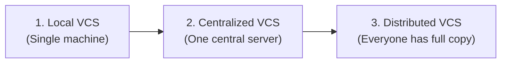

# 01. What is Version Control?

---

## The One-Line Answer

> A **Version Control System (VCS)** is a tool that records every change made to your files so you can go back to any previous version at any time.

---

## Why Does It Exist?

Without version control, developers end up doing this:

```
📁 my-project/
├── app_v1.js
├── app_v2.js
├── app_final.js
├── app_final_fixed.js
└── app_PLEASE_WORK.js
```

This breaks down quickly because:

| Problem | What Happens |
|---|---|
| **Overwriting** | Two people edit the same file — one silently erases the other's work. |
| **No History** | A bug appears and no one knows what changed or when. |
| **No Undo** | Deleted code is gone forever — there's no way to get it back. |

A VCS solves all three: it tracks **who** changed **what**, **when**, and **why** — and lets you undo any of it.

---

## Three Types of Version Control



### 1️⃣ Local VCS
- Keeps a revision database on **your computer only**.
- No collaboration. If your disk dies, everything is lost.
- *Example:* RCS.

### 2️⃣ Centralized VCS (CVCS)
- One **central server** holds the history. Developers download just the latest files.
- **Problem:** Server down = nobody can work. Server crash without backup = history gone.
- *Example:* SVN, Perforce.

### 3️⃣ Distributed VCS (DVCS) ⭐
- Every developer has a **full copy** of the entire repository and history.
- You can commit, branch, and view history **completely offline**.
- If the server crashes, any developer's copy can restore everything.
- *Example:* **Git**, Mercurial.

### Quick Comparison

| | Centralized (SVN) | Distributed (Git) |
|---|---|---|
| History stored at | Server only | **Every developer's machine** |
| Work offline? | ❌ No | ✅ **Yes** |
| Server crash impact | 🔴 Work stops | 🟢 **Work continues** |
| Speed | Slower (network) | **Fast (local disk)** |

---

## Key Terms to Remember

| Term | Meaning |
|---|---|
| **Repository (Repo)** | Your project folder + its entire change history. |
| **Commit** | A saved snapshot of your project at one point in time. |
| **Diff** | The exact lines added or removed between two versions. |
| **Branch** | A separate line of work that doesn't affect the main code. |
| **Merge** | Combining changes from one branch into another. |

---

## 🎯 Interview Ready

**Q: What is a Version Control System and why is it important?**
> A VCS tracks changes to files over time. It is important because it prevents accidental code loss, provides a full audit trail of changes, enables team collaboration through branching, and allows instant rollbacks when bugs are introduced.

**Q: What is the difference between Centralized and Distributed VCS?**
> In Centralized VCS, history lives only on a central server — offline work and commits are not possible. In Distributed VCS like Git, every developer has a complete local copy of the repository, allowing full offline capability and built-in redundancy.

---

> **Next →** [02-why-git.md](./02-why-git.md) — Learn how Git was born and why it became the industry standard.
