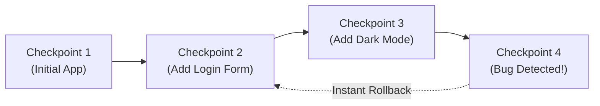
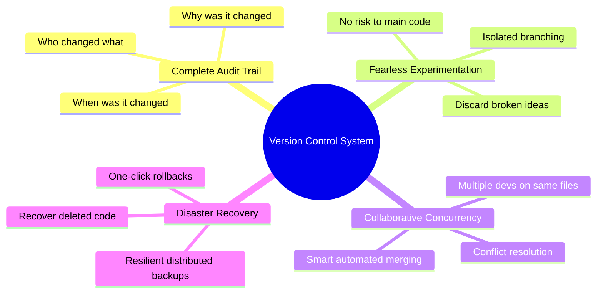
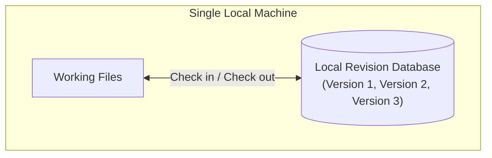
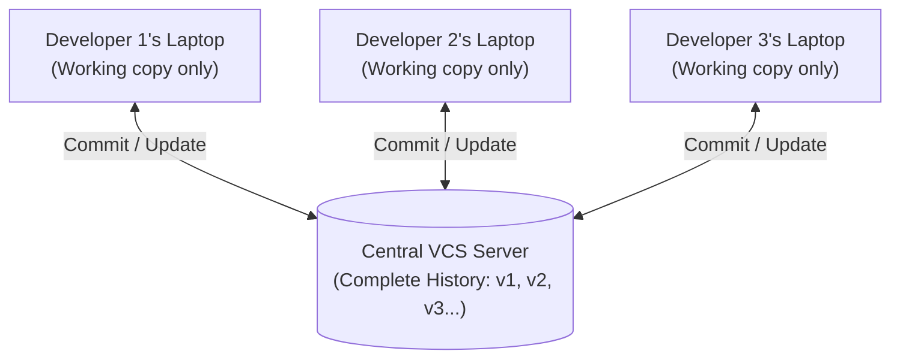
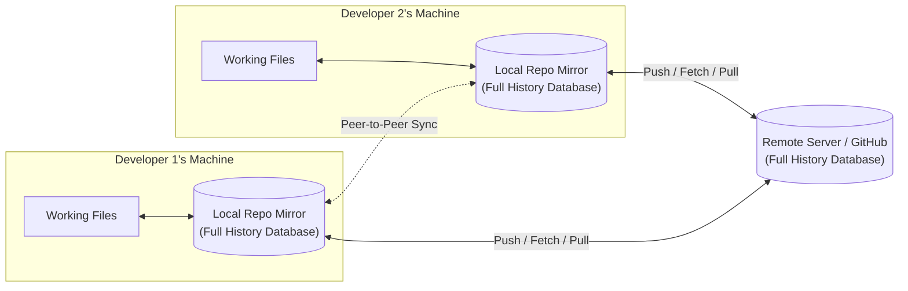
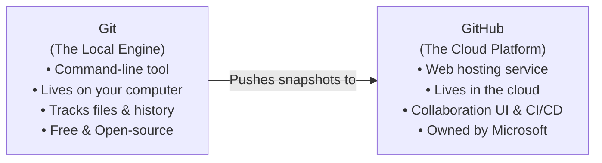

# 01. What is Version Control? 🕹️
### *The Ultimate "Ctrl + Z" Time Machine for Your Codebase*

---

## 💡 The Hook: You've Already Used Version Control (Just the Painful Way)

Be honest—have you ever had a folder on your computer that looked like this?

```text
📁 My_Awesome_Project/
├── project_draft.docx
├── project_draft_v2.docx
├── project_draft_FINAL.docx
├── project_draft_FINAL_v2.docx
├── project_draft_REAL_FINAL_edit.docx
└── project_draft_SUBMIT_THIS_ONE_OR_I_CRY.docx
```

Or maybe you were playing an open-world RPG like *Elden Ring*, *Skyrim*, or *The Witcher*, and right before stepping through a fog door to face a massive boss, you paused and hit **Manual Save** so you wouldn't lose 10 hours of progress if you got wrecked.

That manual save point? That instinct to protect your working state before taking a risk?  
**That is Version Control in a nutshell.**

Except in professional software development, instead of making clunky copies of folders named `project_copy_final_v3`, we use specialized software called a **Version Control System (VCS)** to automate the entire process cleanly, safely, and collaboratively.

---

## 🧠 1. What is Version Control? (From Absolute Zero)

A **Version Control System (VCS)** is a category of software tools that tracks, records, and manages changes to files over time. 

It acts like an **immutable black box flight recorder** and a **multiverse time machine** for your project. Every time you make a meaningful change—whether you add a new login screen, fix a broken button, or delete 500 lines of obsolete code—the VCS allows you to record that state as a permanent checkpoint.



### Demystifying Core Technical Terms
Before going any further, let's translate the essential jargon into plain English:

| Term | Plain-English Definition | Real-Life Analogy |
|---|---|---|
| **Repository ("Repo")** | The master folder containing your project files *plus* the entire history database of every change ever made. | A digital filing cabinet with a built-in memory log. |
| **Commit (Snapshot)** | A permanent record of your files at a specific moment in time, accompanied by a descriptive message, author name, and timestamp. | A photo snapshot with a caption on the back. |
| **Working Directory** | The actual files currently sitting on your filesystem that you can see, edit, and run in your code editor. | Your physical desk where you do active work. |
| **Diff (Delta)** | The exact line-by-line difference between two versions of a file (what was added `+`, what was removed `-`). | The "track changes" view in Microsoft Word or Google Docs. |
| **Rollback / Revert** | Returning a file or the entire repository back to an earlier recorded commit when things go wrong. | An undo button (`Ctrl + Z`) that works across days, weeks, or years. |

---

## 🕰️ 2. Why Was Version Control Introduced?

In the early days of software engineering (1970s–1990s), developers collaborated using primitive methods:
1. **Shared Network Drives (Samba / FTP):** Developers mounted the same network drive and edited live files directly on a server.
2. **Emailing Zip Archives:** Developers compressed their project folders into ZIP files, attached them to emails, and sent them to team members: `build_nov_24_alex.zip`.
3. **Floppy Disks & USB Drives:** Physically walking storage media across the office ("Sneakernet") to share code.

### The Catastrophic Flaws of Old-School Methods:
- **The "Last-Write-Wins" Disaster:** If Developer A and Developer B opened `auth.js` at 2:00 PM, and Developer A saved their changes at 2:15 PM, but Developer B saved their changes at 2:16 PM, Developer B **completely and silently overwrote** all of Developer A's work.
- **Zero Accountability:** When a bug brought down the company's servers at midnight, there was no way to know who touched what line of code, why they did it, or what it looked like before.
- **No Concurrency:** Only one person could safely work on a file at any given moment. Teams had to literally yell across the room: *"Hey, who is currently editing `database.py`?!"*

---

## 🛡️ 3. What Problems Does Version Control Solve?



1. **History & Traceability:** Every change is tied to an author, a timestamp, and a commit message explaining *why* the change happened.
2. **Fearless Experimentation:** You can test crazy new ideas on an isolated branch. If it fails, delete it with zero impact on production code.
3. **Disaster Recovery:** If a bad deploy crashes your application, you can restore the last known healthy state in seconds.
4. **Concurrent Collaboration:** Hundreds of engineers can work on the exact same codebase simultaneously without stepping on each other's toes.
5. **Reproducibility:** You can travel back in time to inspect exactly what the codebase looked like when Version 1.0.0 shipped two years ago.

---

## 💥 4. What Happens When Developers DON'T Use Version Control?

Let's look at a realistic engineering horror story:

> **The Tale of Alex and Priya (Fintech Startup)**  
> 
> Alex and Priya are building an e-commerce checkout system. They aren't using a VCS; instead, they have a shared network folder called `store-app/`.
> 
> 1. **10:00 AM:** Priya opens `checkout.js` to integrate Stripe credit card payments.
> 2. **10:30 AM:** Alex opens `checkout.js` to add Apple Pay support. He doesn't know Priya is working on it.
> 3. **1:00 PM:** Priya finishes 450 lines of Stripe integration code, tests it locally, and saves `checkout.js`. Stripe works perfectly! She heads to lunch.
> 4. **1:15 PM:** Alex finishes his Apple Pay code. He hits **Save**.  
>    **BOOM.** Because Alex started with the 10:30 AM version of the file, his save completely overwrites Priya's Stripe code.
> 5. **2:00 PM:** The team deploys to production. Customers attempt to pay with credit cards—checkout fails immediately. Revenue drops to zero.
> 6. **The Blame Game:** Nobody knows what broke. Priya swears she implemented Stripe. Alex has no idea his save erased her work. There is no backup, no diff, and no recovery. Priya has to spend all night rewriting 450 lines from scratch.

**With a Version Control System:**  
Priya and Alex would work on separate branches. When merging, the VCS would automatically combine non-overlapping edits or prompt them with clear visual conflict markers if they edited the exact same line. No code would ever be lost.

---

## 🏛️ 5. The Three Generations of Version Control Systems

Version control technology evolved across three distinct architectures:

```
Generation 1: Local VCS (1970s - 1980s)
      ▼
Generation 2: Centralized VCS (1990s - 2000s)
      ▼
Generation 3: Distributed VCS (2005 - Present)
```

---

### Type 1: Local Version Control (The Single-Machine Era)

In a Local VCS, all versioning happens strictly on one computer. The system keeps a local database of revision sheets (deltas/patches) under a hidden directory.



- **Example Tools:** RCS (Revision Control System), SCCS.
- **How it works:** It stores diffs between files inside a hidden file structure on your local hard drive.
- **Pros:**
  - Fast because everything is local.
  - Better than naming files `final_v2.zip`.
- **Cons:**
  - **Zero collaboration:** Other developers cannot access your revision database.
  - **Single Point of Failure (SPOF):** If your laptop hard drive dies, the entire project and all historical records perish with it.

---

### Type 2: Centralized Version Control Systems (CVCS)

To solve the collaboration bottleneck, engineers created Centralized Version Control Systems. A single central server houses the complete repository and version history. Developers connect as clients, download only the latest snapshot of the files, make edits, and commit them directly back to the central server.



- **Example Tools:** Subversion (SVN), CVS (Concurrent Versions System), Perforce (Helix Core).
- **Pros:**
  - Everyone knows what everyone else is doing on the project.
  - Granular access control (administrators can grant read/write access down to specific folders).
  - Easy to comprehend conceptual model.
- **Cons:**
  - **Catastrophic Single Point of Failure:** If the central server's hard drive crashes and hasn't been properly backed up, everyone loses everything except the single working snapshot on their local laptop.
  - **Network Dependency:** If you are on an airplane, train, or have no internet connection, you **cannot commit changes, inspect past logs, or create branches**.
  - **Sluggish Performance:** Every single diff, commit, and log lookup requires an active round-trip HTTP/TCP request to the central server.

---

### Type 3: Distributed Version Control Systems (DVCS)

In a Distributed Version Control System, clients don't just check out the latest snapshot of the files—**they mirror the entire repository**, including its full historical timeline, all branches, tags, and commit records.

Every developer's local machine is a complete, self-sufficient backup server.



- **Example Tools:** Git, Mercurial, Bazaar.
- **Pros:**
  - **Blazing Fast Operations:** Commits, diffs, log checks, and branch switches happen locally on your SSD in milliseconds without any network latency.
  - **Offline Resilience:** You can commit 50 times while on a 14-hour flight with zero internet access, and synchronize with the team once you land.
  - **Bulletproof Redundancy:** If the remote hosting server (like GitHub) explodes, any single developer's laptop can be used to restore the entire repository and its entire historical archive.
  - **P2P Collaboration:** Developers can push and pull changes directly between each other's machines without routing through a central server.
- **Cons:**
  - Steeper initial learning curve.
  - Initial repository clone downloads the full history, which can take time for massive multi-gigabyte historical codebases (unless shallow clones or LFS are used).

---

### 📊 Head-to-Head Comparison Matrix

| Feature | Local VCS | Centralized VCS (CVCS) | Distributed VCS (DVCS) |
|---|---|---|---|
| **Primary Architecture** | Single machine database | Single central server + dumb clients | Every node is a full clone repository |
| **Network Required to Commit?** | No | **Yes (Always)** | **No (Completely offline)** |
| **Speed / Performance** | High | Low (Network bound) | Extremely High (Local disk speed) |
| **Single Point of Failure** | Severe (Your machine) | Severe (Central server) | **Virtually None (Distributed redundancy)** |
| **Branching & Merging** | Primitive / Non-existent | Heavyweight, slow, server-dependent | Lightweight, instantaneous, local |
| **Tool Examples** | RCS | SVN, CVS, Perforce | **Git**, Mercurial |

---

## 🏭 6. Real-World Industry Use Cases

Why does every tech giant, financial institution, and startup mandate VCS?

1. **Massive Open Source Projects (Linux, Kubernetes, React):**  
   Thousands of developers spread across 100+ countries submit code daily. DVCS enables maintainers to review, test, and selectively merge isolated contributions without granting random contributors direct write access to the production repository.
2. **High-Frequency Continuous Deployment (Netflix, Amazon, Meta):**  
   Modern tech companies push code to production hundreds of times per day. Automated CI/CD pipelines trigger on every Git commit, running test suites and deploying containerized microservices automatically.
3. **Auditing & Regulatory Compliance (Fintech & Healthcare):**  
   Under SOC2, HIPAA, and PCI-DSS regulations, software companies must prove *who* approved every change to financial or medical systems. Git's cryptographic commit history provides non-repudiable audit logs.
4. **Infrastructure as Code (IaC) & GitOps:**  
   Modern infrastructure (servers, Kubernetes clusters, firewall rules) is written as code using tools like Terraform and Ansible. When an engineer changes server configurations, they do it via a Git commit. If the cluster crashes, reverting that single commit automatically rolls back the physical cloud infrastructure.

---

## 🎯 7. Where Does Git Fit In? (Git vs GitHub)

The most common beginner trap is confusing **Git** with **GitHub**. Let's clear this up once and for all:



- **Git is the Engine:** Created in 2005 by **Linus Torvalds** (the creator of the Linux operating system). It is a free, command-line software tool that runs locally on your machine to manage versions. Git doesn't require an internet connection or an account.
- **GitHub is the Showroom / Garage:** A cloud-based platform that hosts Git repositories online. It adds social collaboration features: Pull Requests, code review interfaces, project management boards, and cloud CI/CD automation.
- *Analogy:* **Git is to GitHub what an Engine is to a Car, or what Video is to YouTube.** You can record a video on your camera without YouTube, but YouTube lets you share that video with the world.

---

## 🚫 8. Common Misconceptions (Busted!)

### ❌ Myth 1: "Git is just a cloud backup tool like Google Drive or Dropbox."
> **Reality:** Cloud drives automatically sync file changes in real-time without context, meaning if you introduce a catastrophic syntax bug, Dropbox happily syncs that broken bug across all your devices instantly. Git requires intentional, authored checkpoints (commits) with contextual explanations. Furthermore, Git understands how to merge parallel branches of code—cloud drives will simply create conflicting copy files like `script (Conflicted Copy).js`.

### ❌ Myth 2: "Git and GitHub are synonymous."
> **Reality:** Git is the underlying version control engine. GitHub is just one of many commercial cloud hosting services for Git. Other popular alternatives include **GitLab**, **Bitbucket**, and self-hosted instances like **Gitea**.

### ❌ Myth 3: "Version control is only for software code."
> **Reality:** Any text-based content benefits immensely from version control. Technical writers use it for documentation, DevOps engineers use it for infrastructure configuration, data scientists use it for ML pipelines, and legal teams increasingly use Git-style systems to draft legislative contracts.

### ❌ Myth 4: "If I make a bad commit, I will ruin the project forever."
> **Reality:** Because Git stores an append-only graph of snapshots, it is remarkably difficult to permanently destroy committed data in Git. Almost every "catastrophic" mistake can be undone using tools like `git revert` or `git reflog`.

---

## ⚡ 9. Quick Revision Notes (TL;DR)

- **Version Control System (VCS):** A tool that tracks and manages file changes over time, providing history, rollbacks, and multi-user collaboration.
- **The Core Problem Solved:** Eliminates accidental file overwrites, unrecorded production bugs, and the nightmare of manually copying project folders.
- **Local VCS (Gen 1):** Stores file patches in a local database. Fast, but strictly single-player and prone to hardware failure.
- **Centralized VCS (Gen 2 - SVN, Perforce):** One central server holds history; clients download snapshots. Enables team visibility, but has a fatal single point of failure and requires constant internet access.
- **Distributed VCS (Gen 3 - Git):** Every developer has a full mirror of the repository and its entire history. Fast, fully offline, highly resilient, and features modern branching.
- **Git vs. GitHub:** Git is the local version control engine; GitHub is the cloud platform for hosting and collaborating on Git repositories.

---

## 🎓 10. High-Yield Interview Questions & Expert Answers

### Q1: What is a Version Control System, and why is it essential in modern software engineering?
**Expert Answer:**  
> "A Version Control System is a software tool that tracks changes to files over time by capturing discrete, immutable snapshots of a project. It is essential because it eliminates the risk of concurrent overwrites, provides a complete historical audit trail of *who* made *what* change and *why*, allows teams to work on independent features simultaneously using isolated branches, and guarantees quick disaster recovery through deterministic rollbacks."

---

### Q2: What is the fundamental difference between Centralized (CVCS) and Distributed (DVCS) version control?
**Expert Answer:**  
> "In a Centralized VCS (like SVN), the repository database and complete change history exist solely on a central server; developers only download a working copy of the current snapshot and must have an active network connection to commit changes or view logs.  
> In contrast, a Distributed VCS (like Git) grants every collaborator a full clone of the repository, including every commit, branch, and historical log. This allows all commit, diff, and branching operations to execute locally at disk speed without network access, while eliminating the central server as a single point of failure."

---

### Q3: What happens if the central server crashes in a CVCS versus a DVCS?
**Expert Answer:**  
> "In a CVCS, a central server crash halts all development: no one can commit new changes, create branches, or inspect history. If the server's storage media is corrupted without recent backups, all project history is permanently lost except for whatever single snapshots developers had checked out locally.  
> In a DVCS, work continues uninterrupted because every developer's local machine contains a complete copy of the historical database. If the remote hosting server (e.g., GitHub) is destroyed, any developer's local repository can be promoted to become the new primary remote with zero loss of historical data."

---

### Q4: How would you explain the difference between Git and GitHub to a non-technical stakeholder?
**Expert Answer:**  
> "Git is the local engine that tracks and saves the history of our work directly on a programmer's computer—similar to the 'Track Changes' feature inside a local word processor. GitHub is a cloud-based collaboration portal—similar to Google Drive or an online gallery—where our team uploads those Git-tracked projects so that developers can review each other's work, automate testing, and coordinate project management."

---

### Q5: Why is Git considered faster than legacy version control systems for branching and diffing?
**Expert Answer:**  
> "Legacy systems like SVN implement branches by physically copying entire directory trees on the central server, which is slow and consumes significant storage. Git implements branches as lightweight, 41-byte pointer files that simply point to a specific 40-character commit hash in an immutable object graph. Furthermore, because Git stores history locally on the developer's machine using content-addressable storage (SHA hashes), comparing branches and generating diffs requires zero network round-trips."
