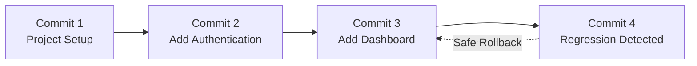
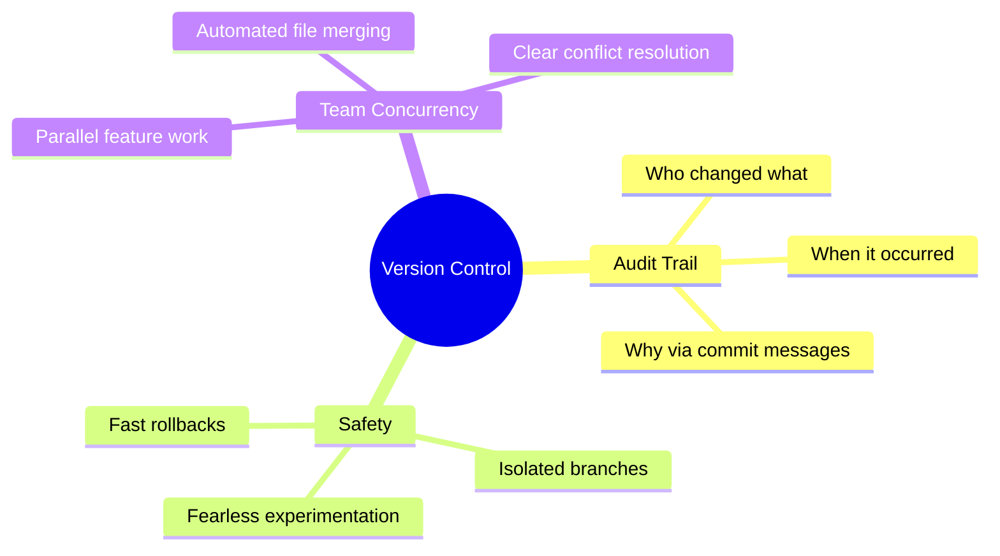
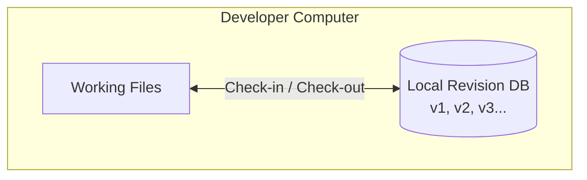
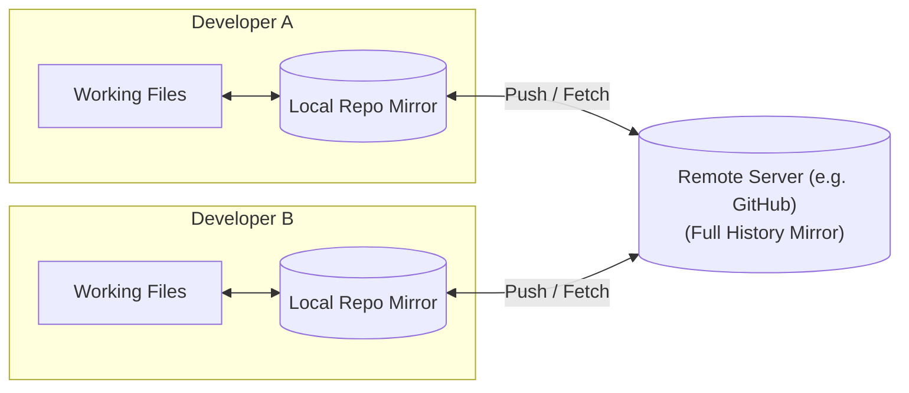
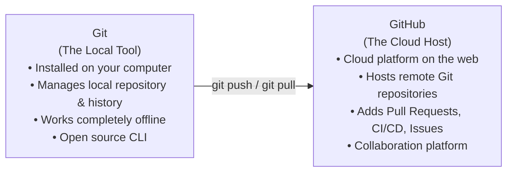

# 01. What is Version Control?
> A clear, foundational guide to Version Control Systems (VCS), why they are critical in software engineering, and how Git fits into the ecosystem.

---

## 1. Introduction: The Problem We Have All Faced

Before understanding Version Control Systems (VCS), consider a scenario almost every computer user has experienced:

```text
📁 My_Project/
├── report_draft.docx
├── report_v2.docx
├── report_final.docx
├── report_final_reviewed.docx
└── report_really_final.docx
```

When you need to make changes to an important file, your natural instinct is to duplicate it. You do this because you want a safe point to return to if your new edits break something.

In professional software development, projects consist of thousands of files worked on by dozens of engineers simultaneously. Manually copying folders or renaming files quickly leads to:
- Overwritten work and lost progress.
- Zero visibility into who made a change or why.
- No reliable way to roll back to a known working version when bugs appear in production.

A **Version Control System (VCS)** is the automated, professional solution to this exact problem.

---

## 2. What is a Version Control System?

A **Version Control System (VCS)** is a software tool that records changes to files over time, allowing developers to recall specific versions later, compare changes, and collaborate without conflict.

Think of it as a comprehensive timeline of your project:



### Essential Terminology

| Term | Technical Definition | Plain-English Concept |
|---|---|---|
| **Repository (Repo)** | The database containing all project files and their complete historical record. | The project folder and its memory. |
| **Commit** | A recorded, immutable snapshot of the project at a specific point in time. | A save point with an author note and timestamp. |
| **Working Directory** | The current local copy of files actively being edited on your machine. | Your active workspace. |
| **Diff (Delta)** | The exact lines added (`+`) or removed (`-`) between two revisions. | The change summary between versions. |
| **Rollback / Revert** | Restoring files or an entire project back to a prior state. | An undo operation across project history. |

---

## 3. Why Was Version Control Introduced?

In early software development (1970s–1990s), teams collaborated using:
- **Shared Network Drives (Samba / FTP):** Developers opened and edited shared files directly on a central network disk.
- **Archive Sharing:** Teams manually emailed ZIP files of the codebase back and forth.

### The Fatal Flaw: The "Last-Write-Wins" Problem

If Developer A and Developer B open `payment.py` at the same time:
1. Developer A writes 100 lines for PayPal integration and saves at 3:00 PM.
2. Developer B writes 50 lines for Credit Card payments and saves at 3:05 PM.

Because Developer B started from the original file, their save **silently overwrites** Developer A's changes. Hours of work vanish with no record of what was lost.

### What Version Control Solves



---

## 4. The Three Types of Version Control

Version control systems evolved through three architectural stages.

---

### Type 1: Local Version Control

Local VCS keeps track of file revisions using a local database stored directly on the developer's computer.



- **Examples:** RCS (Revision Control System), SCCS.
- **Strengths:** Simple, fast, operates locally.
- **Weaknesses:**
  - **No collaboration:** Revisions cannot be easily shared with other team members.
  - **Single Point of Failure:** If the local disk fails, the entire project history is lost.

---

### Type 2: Centralized Version Control (CVCS)

Centralized VCS introduces a dedicated server holding the master repository and history. Developers connect to the server, download a working copy, and commit changes back over the network.

```mermaid
flowchart TD
    Server[("Central VCS Server\n(Complete History Database)")]
    DevA["Developer A\n(Working copy)"]
    DevB["Developer B\n(Working copy)"]

    DevA <-->|Commit / Update (Network)| Server
    DevB <-->|Commit / Update (Network)| Server
```

- **Examples:** Subversion (SVN), CVS, Perforce.
- **Strengths:**
  - Centralized visibility into all team activity.
  - Fine-grained access control over individual directories.
- **Weaknesses:**
  - **Single Point of Failure (SPOF):** If the central server goes down, no one can commit, view logs, or branch.
  - **Network Dependency:** You cannot perform version control actions while offline.
  - **Performance:** History queries and commits require network round-trips.

---

### Type 3: Distributed Version Control (DVCS)

In Distributed VCS, developers do not merely check out the latest snapshot—**they clone the entire repository**, including its complete historical database, locally onto their machine.



- **Examples:** **Git**, Mercurial.
- **Strengths:**
  - **High Performance:** Commits, diffs, log lookups, and branch operations execute locally at disk speed.
  - **Full Offline Capability:** You can create commits, inspect past revisions, and create branches without internet access.
  - **Resilience:** Every developer's machine is a complete backup of the repository. If the remote server fails, any clone can restore it.
- **Weaknesses:**
  - Initial repository cloning takes longer for very large historical codebases (managed in modern teams using Git LFS or shallow clones).

---

### Architecture Comparison

| Feature | Local VCS | Centralized VCS (SVN) | Distributed VCS (Git) |
|---|---|---|---|
| **Repository Storage** | Single local computer | Central server only | Every developer's computer + Remote |
| **Offline Commits?** | Yes | No (Network required) | **Yes (Full offline capability)** |
| **Speed** | Fast | Slow (Network bound) | **Fast (Local disk operations)** |
| **Server Crash Impact** | Local data lost | Complete team blocker | **Work continues locally; easy restore** |
| **Branching & Merging** | Basic / None | Heavyweight, server-managed | **Lightweight, fast, local** |

---

## 5. Real-World Industry Applications

1. **Enterprise Engineering (Microservices & CI/CD):**  
   Companies deploy code multiple times a day. Each commit triggers automated builds and tests, ensuring changes are verified before reaching production.
2. **Open Source Collaboration (Linux, Kubernetes, React):**  
   Thousands of global developers contribute concurrently using isolated branches and pull requests without write access to the main codebase.
3. **Infrastructure as Code (IaC) & GitOps:**  
   Cloud infrastructure (Terraform, Kubernetes manifests) is stored in Git. Reverting a commit automatically rolls back physical cloud resources.
4. **Compliance & Audit Trails (Fintech & Healthcare):**  
   Regulations (SOC 2, ISO 27001) require verifiable records of who authored and approved every production code change.

---

## 6. How Git Fits In: Git vs. GitHub

A common point of confusion for beginners is the relationship between **Git** and **GitHub**:



- **Git** is the version control engine that runs locally on your machine.
- **GitHub** is a cloud hosting service that stores Git repositories online and provides collaboration tooling (Code Reviews, CI/CD via GitHub Actions, Issue Tracking).
- *Analogy:* **Git is the camera; GitHub is Instagram.** You use Git to capture the history, and GitHub to share and collaborate on it.

---

## 7. Common Misconceptions

### 1. "Git is just a cloud backup like Google Drive or Dropbox."
> **Reality:** Cloud storage syncs file changes automatically and indiscriminately. If you introduce a fatal syntax error, Dropbox immediately syncs that broken state everywhere. Git requires deliberate, contextual checkpoints (commits) with explanatory messages and supports branching and deterministic rollbacks.

### 2. "Git and GitHub are the same product."
> **Reality:** Git is an open-source command-line tool created in 2005 by Linus Torvalds. GitHub is a commercial cloud hosting provider (acquired by Microsoft). You can use Git without ever touching GitHub (e.g., using GitLab, Bitbucket, or a private server).

### 3. "If I make a mistake in Git, my code is permanently lost."
> **Reality:** Git uses an append-only object store. Unless files were never committed or explicitly pruned by garbage collection, virtually any commit can be recovered using tools like `git reflog`.

---

## 8. Summary & Key Takeaways

- **Version Control** is the foundation of professional software development, providing traceability, safe collaboration, and rollback capabilities.
- **Centralized VCS (SVN)** depends on a single server, creating a single point of failure and requiring continuous internet connectivity.
- **Distributed VCS (Git)** gives every engineer a full local clone of the repository history, enabling fast, offline, and resilient workflows.
- **Git** is the local version control engine; **GitHub** is the cloud platform for hosting repositories and managing team collaboration.

---

## 9. Interview Questions & Model Answers

### Q1: What is a Version Control System, and why is it standard in software teams?
**Model Answer:**  
> "A Version Control System is a tool that tracks and manages modifications to code over time as discrete snapshots. It is standard practice because it prevents developers from overwriting each other's work, maintains an auditable history of every change, enables parallel development through branching, and provides reliable rollback mechanisms when issues arise."

---

### Q2: What is the primary architectural difference between Centralized and Distributed VCS?
**Model Answer:**  
> "In a Centralized VCS (like SVN), the version history lives exclusively on a central server, meaning developers must have network connectivity to commit changes or view logs. In a Distributed VCS (like Git), each developer has a complete local clone of the entire repository history. This allows all version control operations to run locally and offline, while eliminating the central server as a single point of failure."

---

### Q3: What happens if the primary hosting server crashes in a DVCS like Git?
**Model Answer:**  
> "In a DVCS, development does not stop because every collaborator maintains a complete local mirror of the repository and its history. If the central hosting server (such as GitHub) fails, any team member's local repository can be used to restore the remote repository with zero loss of historical data."

---

### Q4: How would you explain the distinction between Git and GitHub?
**Model Answer:**  
> "Git is the local command-line tool that manages version history on an engineer's machine. GitHub is a web-based hosting service for Git repositories that adds collaboration capabilities such as pull requests, code reviews, access controls, and CI/CD pipelines."

---

### Q5: What is the 'Last-Write-Wins' problem, and how does version control address it?
**Model Answer:**  
> "'Last-Write-Wins' occurs when two engineers edit the same file concurrently without version control; the second engineer who saves the file unintentionally overwrites the first engineer's changes. A VCS prevents this by tracking ancestor baselines and either cleanly merging non-conflicting changes or prompting developers with merge conflicts when concurrent changes overlap."
