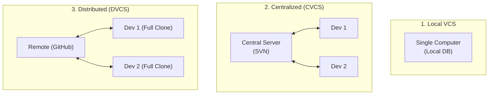

# 01. What is Version Control?

A concise, beginner-friendly guide to Version Control Systems (VCS), core terminology, and key concepts.

---

## 1. What is Version Control?

A **Version Control System (VCS)** is a tool that tracks changes to files over time. It allows you to:
- View the history of your project.
- Revert files or the entire project to an older state.
- Collaborate with others without overwriting each other's work.

> **Simple Analogy:** Think of version control as an automatic save history for your code. Instead of manually creating copies like `project_v1`, `project_v2`, and `project_final`, the tool saves snapshots cleanly in one place.

---

## 2. Why Do We Need Version Control?

Without version control, teams face common problems:
- **Accidental Overwrites:** Two people edit the same file, and the second person erases the first person's work.
- **No Undo History:** If a bug breaks production, there is no quick way to restore the working code.
- **Lack of Accountability:** You cannot tell who changed a line of code, when, or why.

**Version control solves this by providing:**
1. **Change Tracking:** A complete log of every change, author, and timestamp.
2. **Safe Collaboration:** Multiple developers can work on the same codebase simultaneously.
3. **Easy Rollbacks:** Restore any previous working version in seconds.

---

## 3. Core Git & VCS Terminology

| Term | Definition |
|---|---|
| **Repository (Repo)** | The project folder tracked by Git, containing all files and their complete change history. |
| **Commit** | A saved snapshot of your changes with a descriptive message and timestamp. |
| **Working Directory** | The folder on your computer where you currently view and edit your project files. |
| **Staging Area (Index)** | A preparation area where you select which changes will be included in the next commit. |
| **Branch** | An independent line of development used to build new features without affecting main code. |
| **Merge** | Combining changes from one branch into another. |
| **Diff** | The line-by-line difference between two versions of a file. |

---

## 4. Types of Version Control Systems

There are three main types of VCS:

### 1. Local VCS
- Stores revisions in a database on a single computer.
- **Limitation:** No team collaboration; if your hard drive fails, history is lost.
- *Example:* RCS.

### 2. Centralized VCS (CVCS)
- A single central server stores all versions; developers download a copy of the files to work on.
- **Limitation:** Requires internet connectivity to commit or view history. If the server crashes, work stops.
- *Example:* SVN (Subversion), Perforce.

### 3. Distributed VCS (DVCS)
- Every developer clones the **entire repository**, including the full project history, onto their own machine.
- **Advantages:** Works completely offline, operations are fast, and every machine acts as a backup.
- *Example:* **Git**, Mercurial.

---

### Quick Comparison

| Feature | Centralized VCS (e.g. SVN) | Distributed VCS (e.g. Git) |
|---|---|---|
| **History Location** | Central server only | Every developer's machine |
| **Offline Work** | No (requires network) | **Yes (fully offline)** |
| **Speed** | Slower (network dependent) | **Fast (local disk operations)** |
| **Backup Risk** | Server failure is critical | **High redundancy across all clones** |

---

## 5. Git vs. GitHub

These two terms are often confused by beginners:

- **Git** is the **software tool** installed on your computer that tracks file history locally.
- **GitHub** is an **online cloud service** that hosts Git repositories so teams can collaborate remotely.

> **Analogy:** **Git** is like the video camera on your phone; **GitHub** is like YouTube where you upload and share your videos.

---

## 6. Interview Questions & Answers

### Q1: What is Version Control and why is it important?
> **Answer:** Version control is a system that records changes to files over time. It is important because it prevents code loss, enables multiple developers to work together without overwriting code, and allows instant rollbacks if bugs occur.

---

### Q2: What is the difference between Git and GitHub?
> **Answer:** Git is the local command-line version control tool. GitHub is a cloud platform that hosts Git repositories online and provides collaboration features like pull requests and issue tracking.

---

### Q3: What is the main difference between Centralized and Distributed VCS?
> **Answer:** In Centralized VCS (like SVN), the repository history exists only on a central server. In Distributed VCS (like Git), every developer has a full copy of the entire history on their local machine, allowing offline work and providing built-in backups.

---

### Q4: What is a commit in Git?
> **Answer:** A commit is a recorded snapshot of changes in the repository at a specific point in time, accompanied by a commit message, author details, and a timestamp.
