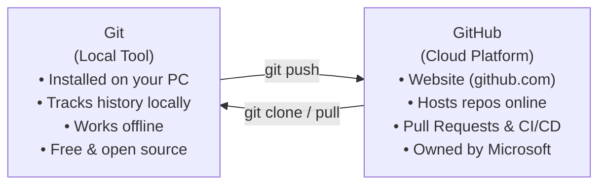

# 02. Why Git?

---

## The Origin Story (30-Second Version)

In **2005**, the Linux kernel team was using a proprietary DVCS called **BitKeeper**. When the free license was revoked, **Linus Torvalds** (the creator of Linux) decided to build his own tool in just **10 days**.

His requirements were simple:
1. **Speed** — Operations must be fast.
2. **Distributed** — Every developer should have the full history locally.
3. **Data Integrity** — Every file is checksummed so corruption is immediately detected.
4. **Non-linear development** — Support thousands of parallel branches.

The result was **Git** — and it quickly became the most widely used version control system in the world.

---

## Why Git Won Over Older Tools

| Feature | SVN (Old Standard) | Git |
|---|---|---|
| **Branching** | Slow — copies entire directory on the server | **Instant** — a branch is just a 41-byte pointer file |
| **Commits** | Requires network connection | **Works offline** — commit anytime, push later |
| **Speed** | Every operation hits the network | **Blazing fast** — everything runs on local disk |
| **Data Safety** | Trusts the server | **Every clone is a full backup** of the repo |
| **Adoption** | Declining | **93%+ of developers worldwide** (Stack Overflow Survey) |

---

## Git vs. GitHub — Know the Difference

This is the **#1 most confused topic** by beginners. They are **not** the same thing.

| | Git | GitHub |
|---|---|---|
| **What is it?** | A software tool (CLI) | A cloud hosting service (website) |
| **Where does it run?** | On your local computer | On the internet |
| **Needs internet?** | No | Yes |
| **Alternatives?** | — | GitLab, Bitbucket, Gitea |

> **Simple Analogy:** Git is the **camera**. GitHub is **Instagram**. You take photos (commits) with Git and share them on GitHub.

---

## Common Misconceptions

| Misconception | Reality |
|---|---|
| "Git and GitHub are the same thing." | Git is the tool. GitHub is one of many cloud hosts for Git repos. |
| "I need internet to use Git." | No. Git works fully offline. You only need internet to push/pull from a remote. |
| "Git is only for code." | Git works with any text files — docs, configs, infrastructure files, data pipelines. |
| "If I mess up a commit, everything is ruined." | Almost nothing is permanently lost in Git. Tools like `git reflog` can recover nearly any mistake. |

---

## 🎯 Interview Ready

**Q: Why was Git created?**
> Git was created in 2005 by Linus Torvalds after the Linux kernel team lost access to BitKeeper. He needed a fast, distributed, and reliable version control system that could handle thousands of contributors working in parallel.

**Q: Why is Git faster than SVN?**
> Git performs all operations (commits, diffs, branching, log lookups) on local disk without any network calls. SVN requires a server round-trip for every operation. Additionally, Git branches are lightweight pointer files, while SVN branches involve copying entire directory trees.

**Q: How would you explain Git vs GitHub to a non-technical person?**
> Git is a tool on your computer that saves the history of your work. GitHub is a website where you upload that work so your team can see it, review it, and collaborate on it.

---

> **Next →** [03-git-architecture.md](./03-git-architecture.md) — Understand how Git actually works under the hood.
