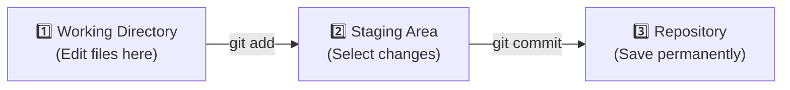
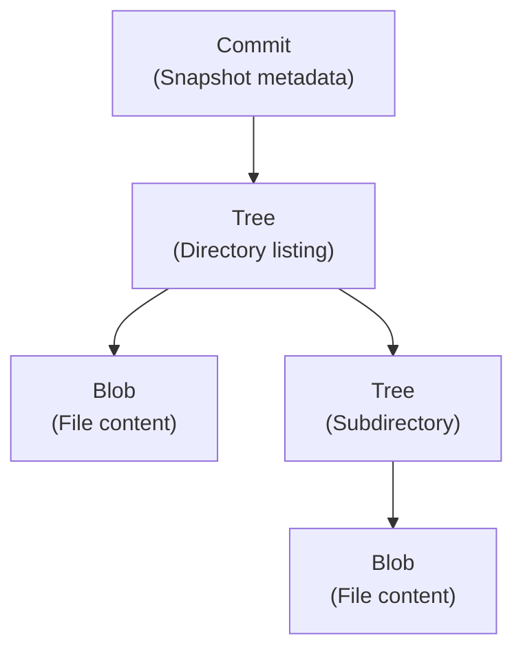

# 03. Git Architecture & Internals

---

## The Big Picture

Git has a simple internal design. Once you understand **two things**, the entire tool makes sense:

1. **The Three Areas** — where your files live as they move through Git.
2. **The Four Object Types** — how Git actually stores your data.

---

## Part 1: The Three Areas

Every file in a Git project passes through three stages:



| Area | What Is It? | Analogy |
|---|---|---|
| **Working Directory** | The files you see and edit in your code editor. | Your desk where you write. |
| **Staging Area (Index)** | A preparation zone where you pick which changes go into your next commit. | A tray where you place only the papers you want to file. |
| **Repository (.git)** | The permanent database of all your commits and history. | The locked filing cabinet. |

### Why does the Staging Area exist?

Without it, every commit would include **all** changed files — you'd have no control. The staging area lets you:
- Edit 5 files but commit only 2 of them.
- Group related changes into one clean, focused commit.
- Review exactly what you're about to save before committing.

---

## Part 2: The Four Git Object Types

Inside the `.git/objects/` folder, Git stores everything as one of four object types. Each object gets a unique **40-character SHA-1 hash** (like a fingerprint).



| Object | What It Stores | Key Point |
|---|---|---|
| **Blob** | The raw content of a single file. | Stores only content — **not** the filename. |
| **Tree** | A directory listing — maps filenames to their Blob hashes. | This is where filenames and folder structure live. |
| **Commit** | The metadata of a snapshot — author, date, message, pointer to root Tree, pointer to parent Commit. | This creates the linked history chain. |
| **Tag** | A permanent label pointing to a specific Commit. | Used for version releases like `v1.0.0`. |

### How they connect in a real commit:

```
Commit (abc123)
├── message: "Add homepage"
├── author: Arpit
├── parent: (none — first commit)
└── tree: (def456)
     ├── index.html → Blob (aaa111)  →  "<html>Hello</html>"
     └── src/        → Tree (bbb222)
          └── app.js → Blob (ccc333)  →  "console.log('hi')"
```

---

## Part 3: Snapshots, Not Deltas

This is a **key difference** between Git and older tools:

| Older VCS (SVN) | Git |
|---|---|
| Stores the **difference** (delta) between each version. | Stores a **full snapshot** of all files with each commit. |
| To read version 5, it must replay: base + diff1 + diff2 + diff3 + diff4 | To read version 5, it directly opens the snapshot. **One step.** |

**But doesn't that waste space?**  
No. If a file hasn't changed between commits, Git doesn't copy it — it just **reuses the pointer** to the existing Blob. This is called **structural sharing**.

---

## Part 4: What's Inside the `.git` Folder?

When you run `git init`, Git creates a hidden `.git/` directory. Here's what matters:

```
.git/
├── HEAD            → Points to your current branch (e.g., refs/heads/main)
├── config          → Settings for this repository
├── index           → The Staging Area (binary file)
├── objects/        → All Blobs, Trees, Commits, and Tags
└── refs/
    ├── heads/      → Branch pointers (main, feature-login, etc.)
    └── tags/       → Tag pointers (v1.0.0, v2.0.0, etc.)
```

> **Key insight:** A branch is not a copy of your code. It's just a tiny text file in `refs/heads/` containing the hash of the latest commit on that branch.

---

## Part 5: How HEAD Works

**HEAD** is a pointer that tells Git: *"Which branch (or commit) am I currently looking at?"*

```
Normal state:         HEAD → refs/heads/main → Commit abc123
After switching:      HEAD → refs/heads/feature → Commit def456
Detached HEAD:        HEAD → Commit abc123 (directly, no branch)
```

- When you commit, the branch HEAD points to moves forward automatically.
- **Detached HEAD** happens when you check out a specific commit instead of a branch. It's not dangerous — just means you're not on any branch.

---

## Summary Cheat Sheet

| Concept | One-Line Summary |
|---|---|
| **Working Directory** | Your actual editable files. |
| **Staging Area** | Where you prepare changes before committing. |
| **Repository** | The permanent history database inside `.git/`. |
| **Blob** | Stores file content (no name). |
| **Tree** | Stores directory structure and filenames. |
| **Commit** | Stores a snapshot with author, message, and parent link. |
| **Tag** | A permanent label on a commit. |
| **HEAD** | Pointer to your currently active branch. |
| **Branch** | A pointer file holding one commit hash. |
| **SHA Hash** | A unique 40-character fingerprint for every Git object. |

---

## 🎯 Interview Ready

**Q: What are the three stages in Git?**
> Working Directory (where you edit), Staging Area (where you prepare), and Repository (where commits are permanently stored). Files move through them using `git add` and `git commit`.

**Q: What are the four object types in Git?**
> Blob (file content), Tree (directory structure), Commit (snapshot with metadata and parent pointer), and Tag (permanent label for a commit).

**Q: Does Git store diffs or snapshots?**
> Git stores full snapshots. If a file hasn't changed, Git reuses the existing object pointer instead of duplicating data — this is called structural sharing.

**Q: What is HEAD in Git?**
> HEAD is a pointer that indicates which branch (or commit) you are currently working on. It usually points to a branch name, which in turn points to the latest commit on that branch.

---

> **Next →** [04-first-steps-with-git.md](./04-first-steps-with-git.md) — Initialize your first repo and make your first commit.
