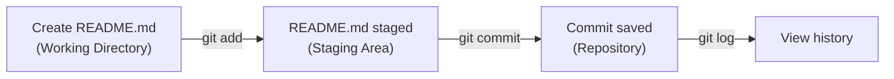

# 04. First Steps with Git

---

## Prerequisites

Before starting, make sure Git is installed:

```bash
git --version
# Output: git version 2.x.x
```

If not installed, download it from [git-scm.com](https://git-scm.com/).

---

## Step 1: Configure Your Identity

Git attaches your name and email to every commit. Set these once globally:

```bash
git config --global user.name "Your Name"
git config --global user.email "your.email@example.com"
```

Verify your config:

```bash
git config --list
```

---

## Step 2: Initialize a Repository

Navigate to your project folder and initialize Git:

```bash
mkdir my-first-repo
cd my-first-repo
git init
```

**What just happened?**  
Git created a hidden `.git/` folder inside your project. This is the repository database. Your project folder is now the **Working Directory**.

Verify:

```bash
ls -a          # Linux/Mac
dir /a         # Windows CMD
Get-ChildItem -Force   # PowerShell
```

You should see the `.git/` directory.

---

## Step 3: Check Repository Status

```bash
git status
```

Output:
```
On branch main
No commits yet
nothing to commit
```

This tells you:
- You are on the `main` branch.
- No files have been committed yet.

---

## Step 4: Create a File and Track It

Create a simple file:

```bash
echo "# My First Repo" > README.md
```

Check the status again:

```bash
git status
```

Output:
```
Untracked files:
    README.md
```

Git sees the file but is **not tracking it yet**. You need to add it to the Staging Area.

---

## Step 5: Stage the File

```bash
git add README.md
```

Check status:

```bash
git status
```

Output:
```
Changes to be committed:
    new file: README.md
```

The file has moved from **Working Directory → Staging Area**. It is now ready to be committed.

---

## Step 6: Make Your First Commit

```bash
git commit -m "Initial commit: add README"
```

Output:
```
[main (root-commit) abc1234] Initial commit: add README
 1 file changed, 1 insertion(+)
 create mode 100644 README.md
```

**What just happened?**
- Git took the staged snapshot and permanently saved it to the Repository.
- It assigned a unique SHA hash (`abc1234...`) to this commit.
- The file has moved from **Staging Area → Repository**.

---

## Step 7: View Your Commit History

```bash
git log
```

Output:
```
commit abc1234... (HEAD -> main)
Author: Your Name <your.email@example.com>
Date:   Tue Nov 26 03:00:00 2026 +0530

    Initial commit: add README
```

For a compact one-line view:

```bash
git log --oneline
```

Output:
```
abc1234 Initial commit: add README
```

---

## The Complete Flow You Just Performed



---

## Explore the `.git` Folder

Now that you have a commit, peek inside the engine:

```bash
cat .git/HEAD
# Output: ref: refs/heads/main

cat .git/refs/heads/main
# Output: abc1234...  (the hash of your commit)
```

This confirms:
- `HEAD` points to `main`.
- `main` points to your commit hash.
- A branch is literally just a file containing a commit hash.

---

## Quick Command Reference

| Command | What It Does |
|---|---|
| `git init` | Creates a new Git repository in the current folder. |
| `git status` | Shows which files are modified, staged, or untracked. |
| `git add <file>` | Moves a file to the Staging Area. |
| `git add .` | Stages **all** changed and new files. |
| `git commit -m "message"` | Saves the staged snapshot with a descriptive message. |
| `git log` | Shows the commit history. |
| `git log --oneline` | Shows a compact one-line-per-commit history. |

---

## 🎯 Interview Ready

**Q: What does `git init` do?**
> It creates a hidden `.git/` directory in the current folder, which initializes an empty Git repository. This directory contains the object database, configuration, and reference pointers.

**Q: What is the difference between `git add` and `git commit`?**
> `git add` moves changes from the Working Directory to the Staging Area (selects what to include). `git commit` takes everything in the Staging Area and saves it as a permanent snapshot in the Repository.

**Q: What information does a Git commit contain?**
> A commit contains a pointer to the root Tree object (the project snapshot), the author name and email, a timestamp, a commit message, and a pointer to the parent commit(s).

---

> ✅ **Module 01 Complete!** You now understand what version control is, why Git exists, how it works internally, and you've made your first commit.  
> **Next Module →** [02-git-configuration](../02-git-configuration/) — Learn how to configure Git for real-world professional use.
