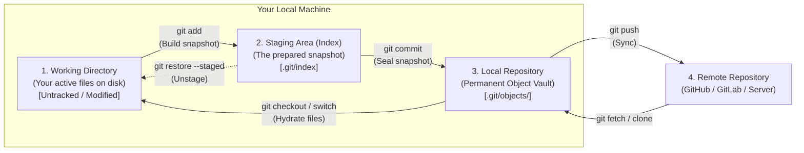
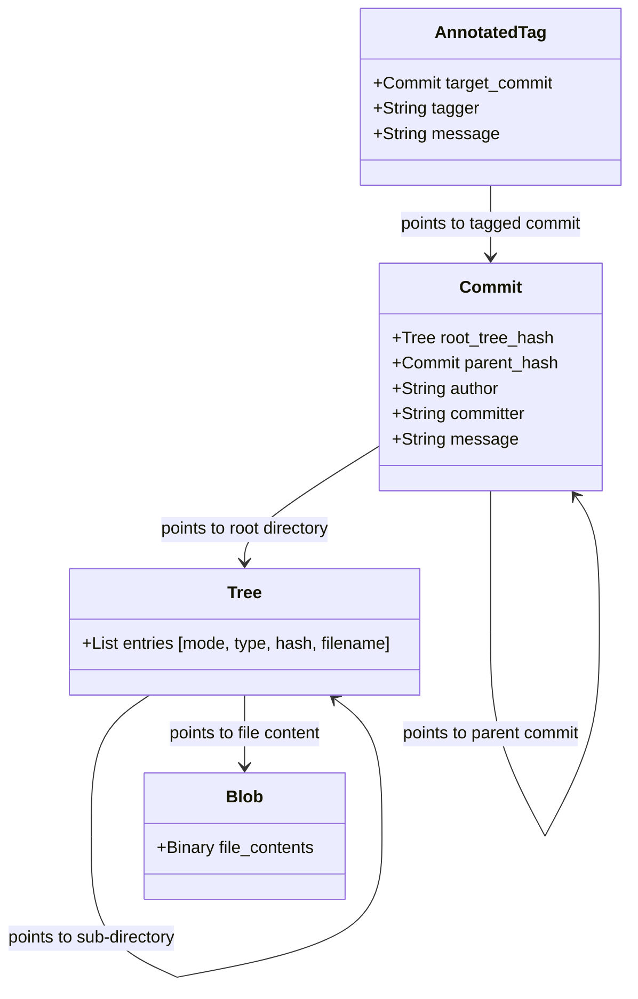

# Git Architecture & Internals 🏗️
### *Demystifying the Three Trees, Object Graph, and Content-Addressable Storage*

---

## 💡 The Hook: Git Isn't Magic, It's Just a Clever Key-Value Store

Most developers treat Git like an ancient wizard spellbook:
- You type `git add .` *(casting the preparation hex)*
- You type `git commit -m "fix stuff"` *(casting the sealing charm)*
- You type `git push` *(teleporting it into the cloud)*

And whenever something goes wrong, panic ensues because nobody knows what actually happened to the files.

Here is the secret senior engineers know:  
**Under the hood, Git is not a complex code tracker. Git is simply a fast, content-addressable key-value object store with a tiny VCS user interface slapped on top.**

Once you understand the **Three Areas (The Three Trees)** and the **Four Core Objects (Blob, Tree, Commit, Tag)**, Git stops being a mystery and becomes as predictable as basic arithmetic.

---

## 🏛️ Part 1: The Three Areas (The "Three Trees" Architecture)

Git does not record changes directly from your hard drive into your repository history. Instead, file changes travel through **three distinct architectural zones**:



### 1. The Working Directory (The Sandbox)
- **What it is:** The actual files you see, edit, run, and delete in VS Code or your terminal.
- **State:** Unsaved in Git's historical record. Files here are either *untracked* (Git doesn't know them) or *modified* (Git sees edits compared to the last commit).
- **Analogy:** Your desk where you draft a letter. You can scribble, crumple papers, and make a mess with zero permanent consequences.

### 2. The Staging Area / The "Index" (The Launchpad)
- **What it is:** A hidden binary file located at `.git/index`. It acts as a holding dock or staging buffer where you curate exactly what will go into your next commit.
- **Why it exists:** Unlike older VCS tools that force you to commit *everything* modified, Git lets you craft surgical, atomic commits. If you edited 5 files, you can stage only 2 of them using `git add` and leave the other 3 for a separate commit.
- **Analogy:** The photo studio runway. You line up exactly the models and props you want in the picture before clicking the shutter.

### 3. The Local Repository (The Permanent Vault)
- **What it is:** The `.git/objects/` database. Once you run `git commit`, Git takes whatever was queued up in the Staging Area, seals it into an immutable snapshot, and attaches author metadata and a timestamp.
- **State:** Permanent, encrypted, and safely recorded in your local history graph.
- **Analogy:** The locked, fireproof archive where the developed photo is framed and cataloged with a date and signature.

---

## 🧬 Part 2: The Core Object Database (The Four Sacred Objects)

Inside the hidden `.git/objects/` folder, Git stores everything as **compressed objects** indexed by a **40-character hexadecimal SHA-1 hash** (or SHA-256 in newer configurations).

This is what **Content-Addressable Storage** means:  
The filename and location of the object in the database are derived directly from the cryptographic hash of its contents. If the content changes by even one comma, the hash completely changes.

There are only **four fundamental object types** in the Git universe:



### 1. The Blob (Binary Large Object)
- **What it stores:** Pure file content (raw bytes).
- **What it DOES NOT store:** It does **not** store the filename, file permissions, or creation date!
- **Key Insight:** If you have five completely different files across five different folders that all contain the text `"hello world"`, Git only stores **one single blob** in `.git/objects/`. That is instant deduplication!

### 2. The Tree (Directory Manifest)
- **What it stores:** Directory structures and file metadata.
- A Tree object is essentially a text list containing:
  - File permissions (e.g., `100644` for normal file, `100755` for executable)
  - Object type (`blob` or `tree`)
  - The SHA-1 hash of the object
  - The human-readable name of the file or subfolder (e.g., `index.html`, `src/`)

### 3. The Commit (The Snapshot Envelope)
- **What it stores:** The permanent snapshot identity. It contains:
  - A pointer to the **top-level root Tree object** representing the repository at that exact moment.
  - A pointer to the **Parent Commit(s)** (this creates the linked Directed Acyclic Graph / DAG of history).
  - The Author and Committer (Name, Email, Timestamp).
  - The Commit Message.

### 4. The Annotated Tag (The Permanent Landmark)
- **What it stores:** A permanent reference object that points to a specific commit hash, accompanied by a tagger name, date, and release message (e.g., `v1.0.0`).

---

## 📸 Part 3: How the Objects Connect in a Real Commit

Let's visualize what happens when you commit a project with a `README.md` and a `src/app.js` file:

```mermaid
flowchart TD
    CommitNode["Commit Object: 9a3f2b\nAuthor: Priya\nMessage: 'Initial commit'\nParent: None"]
    
    RootTree["Root Tree: 18c94e\n• README.md (Blob: 4d2e11)\n• src/ (Tree: 7f81a0)"]
    
    BlobReadme["Blob: 4d2e11\nContent: '# Welcome to my app'"]
    
    SubTreeSrc["Subtree 'src/': 7f81a0\n• app.js (Blob: e3b890)"]
    
    BlobApp["Blob: e3b890\nContent: 'console.log(\"Hello\");'"]

    CommitNode --> RootTree
    RootTree --> BlobReadme
    RootTree --> SubTreeSrc
    SubTreeSrc --> BlobApp
```

### What Happens in the Next Commit If You Only Edit `app.js`?
This is where Git's brilliance shines:
1. Git writes a **new Blob** for the updated `app.js`.
2. Git writes a **new Tree** for `src/` pointing to the new `app.js` blob.
3. Git writes a **new Root Tree** pointing to the new `src/` tree, but reuses the **exact same old Blob hash** for `README.md`!
4. Git writes a **new Commit** pointing to the new Root Tree, with its parent set to the first commit.

> [!TIP]
> **Structural Sharing:** Git never duplicates files that haven't changed. It simply points the new tree to the pre-existing blob in the database. This is why Git is lightning-fast and repository sizes stay remarkably compact.

---

## ⚡ Part 4: Snapshots vs Deltas (Git vs Older VCS)

Why did older systems like SVN slow down to a crawl as projects grew, while Git remains blazing fast?

```
Older VCS (Delta-based):
Version 1: [Base File A]          [Base File B]
Version 2: [Diff A.1]             (No change)
Version 3: [Diff A.2]             [Diff B.1]
To read Version 3 of File A, SVN had to compute: Base + Diff A.1 + Diff A.2

Git (Snapshot-based with Structural Sharing):
Commit 1:  [Blob A1]              [Blob B1]
Commit 2:  [Blob A2 (new)]        [Blob B1 (pointer reused!)]
Commit 3:  [Blob A3 (new)]        [Blob B2 (new)]
To read Commit 3 of File A, Git instantly opens [Blob A3] in 1 read operation!
```

---

## 📂 Part 5: Peeking Inside the `.git` Directory

Run `ls -la .git` inside any initialized Git repository, and you will see the engine room:

```text
.git/
├── HEAD               # Text file pointing to the currently checked-out branch (e.g. ref: refs/heads/main)
├── config             # Repository-specific configuration settings
├── description        # Used primarily by GitWeb (mostly ignored today)
├── hooks/             # Client-side scripts triggered on events (pre-commit, pre-push)
├── info/              # Contains the global exclude file
├── index              # The binary Staging Area file!
├── objects/           # The Content-Addressable Object Database (blobs, trees, commits, tags)
└── refs/              # Pointers to commits (branches and tags)
    ├── heads/         # Local branch pointers (e.g., main -> commit hash)
    ├── remotes/       # Remote tracking branch pointers (e.g., origin/main)
    └── tags/          # Tag pointers
```

---

## 🕵️ Part 6: Hands-on Lab: Inspecting Git's Plumbing

Let's prove this architecture using Git's low-level **plumbing commands**. (Commands developers normally use like `add` and `commit` are called **porcelain** commands; the low-level engine tools are called **plumbing**).

### Experiment: Create a Blob Manually Without Staging Files

#### 1. Hash some text into Git's object store directly:
```bash
echo "Hello CommitCraft Internals" | git hash-object -w --stdin
```
*Output:*
```text
8b2d28b6d4f6ef847ea6984e030eb8a07c3fb3c2
```

#### 2. Check what type of object Git created:
```bash
git cat-file -t 8b2d28b6d4f6ef847ea6984e030eb8a07c3fb3c2
```
*Output:*
```text
blob
```

#### 3. Inspect the contents stored inside that hash:
```bash
git cat-file -p 8b2d28b6d4f6ef847ea6984e030eb8a07c3fb3c2
```
*Output:*
```text
Hello CommitCraft Internals
```

#### 4. Find the physical file on your disk:
Look inside `.git/objects/8b/`:
You will find a file named `2d28b6d4f6ef847ea6984e030eb8a07c3fb3c2`. Git splits the 40-character SHA hash: the first 2 characters become the folder name, and the remaining 38 characters become the filename to prevent filesystem directory clutter.

---

## 🚫 Common Misconceptions Busted

### ❌ Myth 1: "Git stores file differences (deltas) on every commit."
> **Reality:** Git stores **full snapshots** as discrete blobs. It only compresses similar blobs into delta "packfiles" during periodic maintenance (`git gc` / garbage collection) to save disk space.

### ❌ Myth 2: "A blob object knows its filename."
> **Reality:** A blob is completely anonymous—it only knows its compressed file contents and its SHA hash. The filename is strictly stored in the **Tree** object that references that blob.

### ❌ Myth 3: "A branch in Git is a heavy copy of the code."
> **Reality:** A branch in Git is literally a 41-byte plain-text file in `.git/refs/heads/<branch-name>` containing nothing more than a 40-character commit hash followed by a newline! Creating a branch takes less than 1 millisecond.

---

## ⚡ Quick Revision Summary

- **The Three Trees:** Working Directory (where you edit) ➔ Staging Area / Index (where you curate) ➔ Local Repository (where you permanently seal).
- **Content-Addressable Storage:** Files are identified and retrieved strictly by their cryptographic SHA content hash.
- **The 4 Objects:**
  - **Blob:** File contents only.
  - **Tree:** Folders, filenames, and permissions.
  - **Commit:** Author, timestamp, message, root tree pointer, parent commit pointer.
  - **Tag:** Permanent named reference pointing to a commit.
- **Structural Sharing:** Unchanged files between commits are not duplicated; their existing SHA pointers are reused in the new tree.
- **Branches & HEAD:** Branches are just pointer files referencing commits. `HEAD` is a pointer referencing your active branch.

---

## 🎓 5 Senior-Level Interview Questions & Answers

### Q1: What does it mean that Git is a "content-addressable filesystem"?
**Answer:**  
> "It means object storage and retrieval are keyed entirely by the cryptographic hash (SHA-1 or SHA-256) of the object's contents rather than an arbitrary user-defined identifier or filesystem path. If two files in different directories have identical contents, they share the exact same hash and only one blob is stored, providing automatic content-level deduplication."

---

### Q2: Why are file names stored in Tree objects rather than inside Blob objects?
**Answer:**  
> "Separating file contents from file metadata allows maximum deduplication and structural sharing. Because a Blob contains only raw file data, renaming a file or moving it to another directory doesn't create a new Blob object—it merely creates a new lightweight Tree object that maps the new file name or path to the existing Blob hash."

---

### Q3: Explain how Git commits form a Directed Acyclic Graph (DAG).
**Answer:**  
> "Every commit object contains one or more cryptographic pointers to its immediate parent commit(s). These directional pointers flow backward in time from child to parent, forming a graph where history never loops back on itself (acyclic). This DAG structure makes branch creation, history navigation, and three-way merging mathematically deterministic."

---

### Q4: What is the purpose of the `.git/index` file, and what happens to it when you run `git add`?
**Answer:**  
> "The `.git/index` file is the binary data store representing the Staging Area. When you run `git add <file>`, Git compresses the file's current contents into a new Blob in `.git/objects/`, computes its SHA hash, and records the file path, permissions, and new Blob hash into the `.git/index` file. When you subsequently run `git commit`, Git builds the root Tree object directly from this index."

---

### Q5: How does Git distinguish between a Fast-Forward merge and a Three-Way merge at the architectural level?
**Answer:**  
> "In a Fast-Forward merge, the target branch tip is a direct linear ancestor in the DAG of the incoming branch tip; Git simply advances the target branch pointer to point to the incoming commit hash without creating any new commit object. In a Three-Way merge, the branches have diverged from a common ancestor; Git must locate the Lowest Common Ancestor (LCA) commit, compare the differences between the ancestor and the two tips, create a new merged tree, and write a new merge commit object containing two parent hashes."
