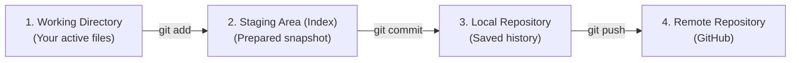
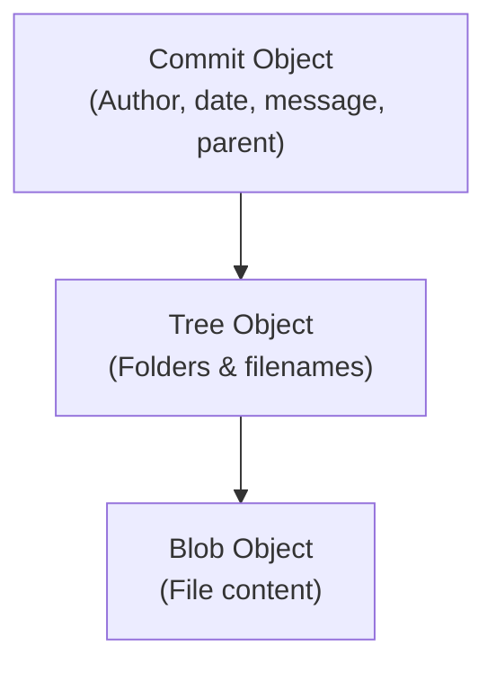

# Git Architecture & Internals

A concise guide to Git's three-area architecture, core object types, and internal storage model.

---

## 1. The Three Areas of Git (The Three Trees)

Git does not track files directly from your folder into history. Instead, files move through **three distinct areas**:

| Area | What It Is | Purpose |
|---|---|---|
| **1. Working Directory** | The actual files on your computer that you open and edit in your code editor. | Your active workspace where you make changes. |
| **2. Staging Area (Index)** | A hidden file (`.git/index`) that prepares which changes will go into your next commit. | Allows you to select and organize changes before saving them. |
| **3. Local Repository** | The database inside the hidden `.git/objects/` folder containing all saved commits. | Your permanent project history stored on your local disk. |

---

## 2. The Four Core Git Objects

Inside `.git/objects/`, Git stores everything using four basic object types, each identified by a unique **40-character SHA hash**:

| Object Type | What It Stores | Key Detail |
|---|---|---|
| **Blob (Binary Large Object)** | Raw file contents. | Does **not** store filenames or permissions—only file data. |
| **Tree** | Directory lists (folders and filenames). | Maps filenames and file permissions to their respective Blob hashes. |
| **Commit** | A permanent snapshot. | Points to the root Tree, parent commit(s), author name, date, and message. |
| **Tag** | A permanent reference/label. | Points directly to a specific commit (e.g., `v1.0.0`). |

---

## 3. How Git Stores Data: Snapshots vs. Deltas

- **Older VCS (like SVN):** Stored differences (deltas) from version to version (e.g., base file + edit 1 + edit 2).
- **Git:** Stores a **complete snapshot** of all files with each commit.
- **Efficiency:** If a file hasn't changed between commits, Git does **not** duplicate it—it simply links to the existing Blob from the previous commit.

---

## 4. Inside the `.git` Directory

When you run `git init`, Git creates a hidden `.git` folder containing:

| Folder / File | What It Does |
|---|---|
| `HEAD` | A text file pointing to the branch you are currently on (e.g., `refs/heads/main`). |
| `config` | Stores settings specific to this repository. |
| `index` | The binary file representing the Staging Area. |
| `objects/` | The database holding all Blobs, Trees, Commits, and Tags. |
| `refs/heads/` | Pointers to your local branches (each branch file holds the commit hash it points to). |

---

## 5. Interview Questions & Answers

### Q1: What are the three stages of Git and why do we need the staging area?
> **Answer:** The three stages are the **Working Directory**, the **Staging Area (Index)**, and the **Local Repository**. The staging area is necessary because it lets developers selectively choose which modified files to include in a commit, allowing for clean, atomic commits.

---

### Q2: What are the four core objects Git uses to store data?
> **Answer:** 
> 1. **Blob:** Stores file content.
> 2. **Tree:** Stores directory structure and filenames.
> 3. **Commit:** Stores snapshot metadata, author, message, and pointers to the root tree and parent commit.
> 4. **Tag:** Stores an annotated label pointing to a commit.

---

### Q3: Does Git store file differences (deltas) or full snapshots?
> **Answer:** Git stores full snapshots with each commit. To stay lightweight, if a file hasn't changed, Git reuses the pointer to the existing Blob rather than copying the file again.

---

### Q4: What is a branch in Git at the architectural level?
> **Answer:** A branch in Git is simply a lightweight, 41-byte text file located in `.git/refs/heads/` that contains the 40-character commit hash of the branch's latest commit.
