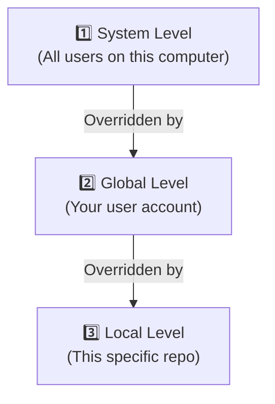

# 01. Configuration Levels

---

## How Git Stores Settings

Git doesn't have one single config file. It uses **three levels**, each stored in a different location. Settings at a more specific level **override** settings at a broader level.



---

## The Three Levels

| Level | Scope | Config File Location | Flag |
|---|---|---|---|
| **System** | Every user on the machine | `/etc/gitconfig` (Linux/Mac) or `C:\Program Files\Git\etc\gitconfig` (Windows) | `--system` |
| **Global** | Your user account (all your repos) | `~/.gitconfig` or `%USERPROFILE%\.gitconfig` | `--global` |
| **Local** | Only the current repository | `.git/config` inside the repo | `--local` |

### Precedence Rule

> **Local > Global > System**
>
> If the same setting exists at multiple levels, the **most specific** (Local) wins.

**Example:** If your Global config says `user.email = personal@gmail.com` but a specific repo's Local config says `user.email = work@company.com`, then inside that repo your commits will use `work@company.com`.

---

## Useful Commands

### Set a value

```bash
git config --global user.name "Arpit"       # Global level
git config --local user.email "work@co.com"  # Local level (this repo only)
```

### Read a value

```bash
git config user.name                          # Shows effective value
git config --global user.email                # Shows global value specifically
```

### View all settings with their source

```bash
git config --list --show-origin
```

This is the most useful debugging command — it shows **every** setting and **which file** it comes from:

```
file:/home/arpit/.gitconfig    user.name=Arpit
file:/home/arpit/.gitconfig    user.email=personal@gmail.com
file:.git/config               user.email=work@company.com    ← overrides global
```

### Remove a setting

```bash
git config --global --unset user.name
```

---

## Edit Config Files Directly

You can also open the config file in your editor:

```bash
git config --global --edit    # Opens ~/.gitconfig in your editor
git config --local --edit     # Opens .git/config for current repo
```

---

## 🎯 Interview Ready

**Q: What are the three Git configuration levels and what is their precedence?**
> Git has System (applies to all users), Global (applies to your user account), and Local (applies to a single repository) configuration levels. Local overrides Global, and Global overrides System.

**Q: How would you check where a Git setting is coming from?**
> Run `git config --list --show-origin` — it lists every active setting along with the exact file path it was loaded from.

---

> **Next →** [02-essential-settings.md](./02-essential-settings.md) — Set up your identity, editor, line endings, and aliases.
