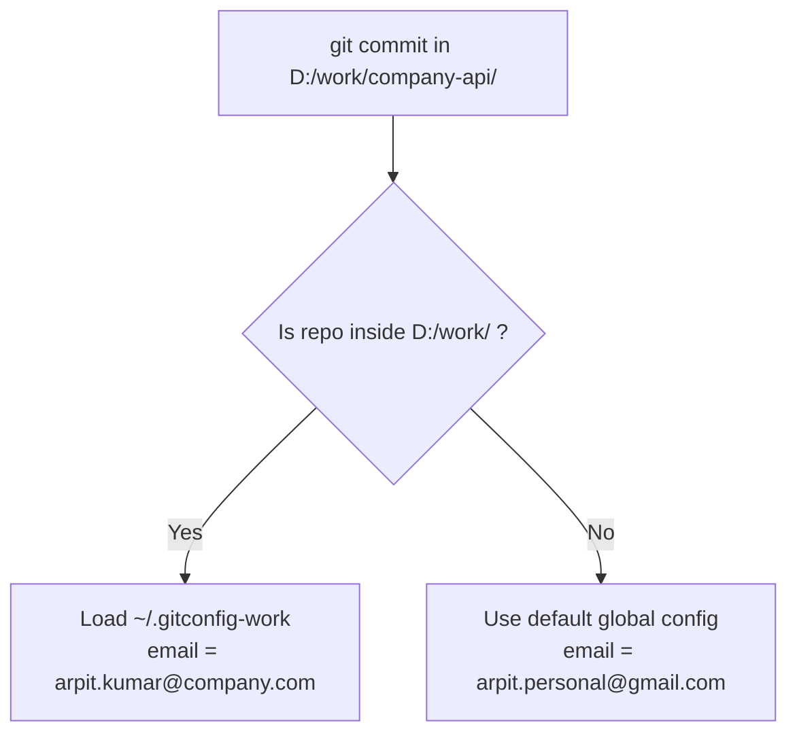

# 04. Multi-Profile Setup

---

## The Problem

You have two (or more) Git identities:

| Context | Name | Email |
|---|---|---|
| **Personal projects** | Arpit | arpit.personal@gmail.com |
| **Work projects** | Arpit Kumar | arpit.kumar@company.com |

If you only set a global `user.email`, **all** your commits — personal and work — will use the same email. That means your personal GitHub contributions may show your company email, or your work commits may show your personal email.

---

## Solution: Conditional Includes (`includeIf`)

Git lets you automatically load different settings based on **which folder** a repository is in.

### Step 1 — Organize your projects by folder

```
D:\
├── personal/          ← Personal repos go here
│   ├── side-project/
│   └── portfolio/
└── work/              ← Work repos go here
    ├── company-api/
    └── internal-tool/
```

### Step 2 — Create separate config files

**Create `~/.gitconfig-personal`:**

```ini
[user]
    name = Arpit
    email = arpit.personal@gmail.com
```

**Create `~/.gitconfig-work`:**

```ini
[user]
    name = Arpit Kumar
    email = arpit.kumar@company.com
```

### Step 3 — Add conditional includes to your global config

Edit your main `~/.gitconfig`:

```ini
[user]
    name = Arpit
    email = arpit.personal@gmail.com

[init]
    defaultBranch = main

# Load work config for repos inside D:/work/
[includeIf "gitdir:D:/work/"]
    path = ~/.gitconfig-work

# Load personal config for repos inside D:/personal/
[includeIf "gitdir:D:/personal/"]
    path = ~/.gitconfig-personal
```

### How it works



- When you commit inside `D:/work/`, Git automatically uses your work email.
- When you commit inside `D:/personal/`, Git automatically uses your personal email.
- **No manual switching needed.** It just works based on the folder.

### Step 4 — Verify

Navigate to a work repo and check:

```bash
cd D:/work/company-api
git config user.email
# Output: arpit.kumar@company.com

cd D:/personal/portfolio
git config user.email
# Output: arpit.personal@gmail.com
```

---

## Important Notes

| Point | Detail |
|---|---|
| **Trailing slash matters** | `gitdir:D:/work/` must end with `/` to match all repos inside that directory. |
| **Case sensitivity** | On Windows, paths are case-insensitive. On Linux/Mac, they are case-sensitive. |
| **Works with any setting** | You can put any Git config inside the included files — not just `user.name` and `user.email`. For example, different signing keys for work vs personal. |

---

## Alternative: Per-Repo Local Config

If you only have a few repos that need a different identity, you can set it directly inside the repo without `includeIf`:

```bash
cd D:/work/company-api
git config --local user.name "Arpit Kumar"
git config --local user.email "arpit.kumar@company.com"
```

This only affects that one repo. Use `includeIf` when you have many repos under the same folder.

---

## 🎯 Interview Ready

**Q: How do you manage multiple Git identities (e.g., personal and work) on the same machine?**
> Use conditional includes (`includeIf`) in the global `~/.gitconfig` file. By organizing repositories into separate directories (e.g., `~/personal/` and `~/work/`), Git can automatically load different config files based on the repository's location, applying the correct name, email, and signing key without any manual switching.

**Q: What is the difference between `includeIf` and `--local` config?**
> `--local` config sets a value for a single specific repository. `includeIf` applies an entire config file to all repositories under a matching directory path, making it scalable when you have many repos that need the same override.

---

> ✅ **Module 02 Complete!** You now know how to configure Git at every level, set up authentication, and manage multiple identities.  
> **Next Module →** [03-essential-commands](../03-essential-commands/) — Learn the day-to-day Git commands you'll use constantly.
